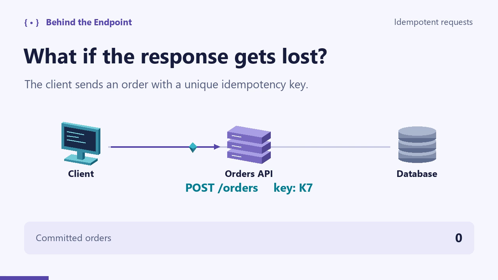

# Behind the Endpoint

Follow a request from the browser to the database and back. Behind the Endpoint teaches backend development through 18 interactive lessons with step-by-step 3D diagrams, runnable JavaScript examples, and practice questions.

[Open the live app](https://behind-the-endpoint.vercel.app) · [Start the first lesson](https://behind-the-endpoint.vercel.app/learn/1/1)

## Two requests, one order

What happens if the server creates an order but the client never receives the confirmation? This 21-second animation follows the retry and shows how an idempotency key lets the server return the original order.

[](public/videos/safe-retries.mp4)

[Open the MP4](public/videos/safe-retries.mp4) · [Try the safe retries lesson](https://behind-the-endpoint.vercel.app/learn/15/1)

## Explore the course

Step through request handling, API design, databases, identity and access, background jobs, and service operations. Each lesson includes an example you can run with different inputs. The request lab lets you send simulated GET and POST requests, and the searchable cheatsheets make it easy to revisit a concept.

## Run locally

With Node.js 22 and npm installed, run these commands from the repository root.

```sh
npm ci
npm run dev
```

Open [localhost:3000](http://localhost:3000). Run `npm run typecheck` to check TypeScript or `npm run build` to generate the production build.

Built with Next.js App Router, TypeScript, Tailwind CSS, and Three.js.
